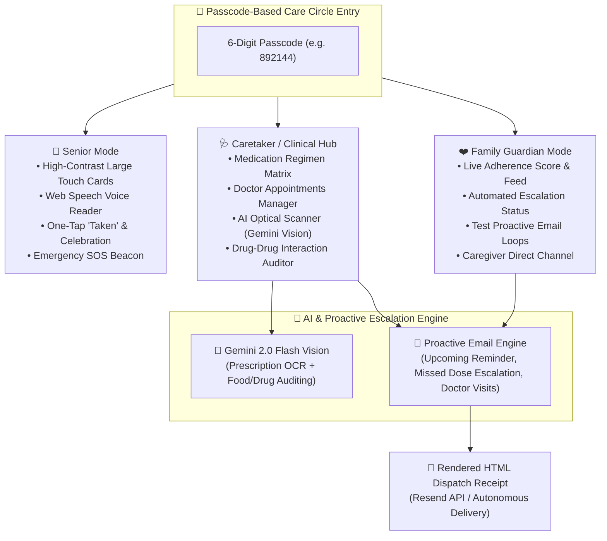

# CareNest — Intelligent Elderly Care & Medication Guardian

> **Catalyst 2026 Solo AI Hackathon Submission**  
> *Track: Elderly Care & Medication Management Platform*  
> *Solo Developer Project • Built with Next.js 16, TypeScript, Tailwind CSS, Google Gemini 2.0 Flash, and Proactive Email Escalation*

---

## 🌟 Executive Summary & Problem Solved

Elderly healthcare management is plagued by dangerous medication non-adherence, accidental double-dosing, and fragmented communication between seniors, family members, and clinical caregivers.

**CareNest** solves this with an interconnected healthcare ecosystem that:
1. **Puts the Senior at the Center of Care:** A barrier-free interface with high contrast, large touch targets, built-in **Web Speech Voice Guidance**, one-tap dose logging with positive reinforcement, and a dedicated Emergency SOS beacon.
2. **Gives Family Real-Time Peace of Mind:** Real-time compliance score (%), live caregiver activity feed, and autonomous email escalation only when attention is actually required—ending the stressful cycle of daily nagging.
3. **Equips Caretakers with Clinical AI Safety:** An **AI Prescription & Pill Bottle Scanner** powered by **Google Gemini Multimodal Vision** that automatically extracts dosages, food caveats, and audits active prescriptions for life-threatening drug-drug interactions.
4. **Autonomous Proactive Escalation Engine:** Automated email notifications for upcoming doses, medical appointments with prep checklists, and critical escalation alerts when a dose is missed beyond the grace period.
5. **Secure Passcode-Based Care Circle Access:** Frictionless 6-digit passcode authentication (`892144`) connecting all three roles without cumbersome account switching.

---

## 🏛️ System Architecture



---

## 🎯 Innovation: Beyond a Basic Reminder App

| Feature | Conventional Reminder Apps | **CareNest** |
| :--- | :--- | :--- |
| **Prescription Entry** | Tedious manual form filling prone to typos. | **Gemini Multimodal Vision OCR**: Snap a photo or choose a sample Rx; auto-populates drug, dosage, frequency, and instructions. |
| **Drug Interaction Safety** | No conflict detection. | **Clinical Safety Auditor**: Cross-checks new prescriptions against active medications to flag adverse synergies (e.g., Amlodipine + Lisinopril hypotension). |
| **Elderly Usability** | Tiny fonts, complex navigation, difficult passwords. | **Senior-First UX**: Voice synthesis read-aloud, 24pt+ typography, audio chime confirmation, and joyful confetti reinforcement. |
| **Care Coordination** | Fragmented across separate apps or text messages. | **Tri-Persona Care Circle**: Senior, Family, and Caretaker collaborate within a unified 6-digit passcode ecosystem. |
| **Escalation Protocol** | Passive push notifications that get dismissed. | **Proactive Escalation Loop**: Automatically emails family and nurse Elena if a scheduled dose is neglected > 30 minutes. |

---

## 🚀 Key Features by Persona

### 1. 👴 Elderly Individual (Arthur Pendelton, 76)
- **Time-Aware Greeting & Focal Dose Card:** Prominently displays the exact pill due right now.
- **🔊 Voice Guidance (Read My Schedule):** Uses Web Speech API to read out Arthur's daily medication schedule and dietary instructions aloud.
- **Joyful Dose Confirmation:** Clicking *"I TOOK THIS MEDICINE"* fires confetti, produces a harmonic audio chime, and gives vocal encouragement.
- **Daily Wellness Check-in:** 4 one-tap mood/pain icons (Feeling Great 😊, Pretty Good 🙂, A Bit Tired 🥱, Not Feeling Well 🤕) that sync directly to the family dashboard.
- **🚨 One-Tap Emergency SOS:** Triggers an emergency broadcast with a 5-second cancel buffer.

### 2. ❤️ Family Guardian (Sarah Pendelton - Daughter)
- **Peace-of-Mind Live Feed:** See exact timestamps of taken medications (e.g., *"Arthur took Metformin HCl 500mg at 8:05 AM with oatmeal"*).
- **Adherence Score Ring:** Real-time percentage tracking for peace of mind.
- **Interactive Escalation Test Controls:** Instant simulation of missed dose alerts, upcoming dose reminders, and doctor appointment emails.

### 3. 🩺 Caretaker & Clinical Coordinator (Nurse Elena Vance, RN)
- **Complete Medication Regimen Matrix:** Add, edit, delete, and monitor stock pill counts.
- **AI Optical Prescription & Pill Scanner:** Powered by Google Gemini 2.0 Flash to scan prescriptions and review food/drug warnings.
- **Doctor Appointments & Routines Planner:** Schedule visits with clinics, doctors, and prep instructions (e.g., *"Fasting 8 hours for HbA1c test"*), with one-click email reminder dispatch.

---

## 💻 Tech Stack & Repository Health

- **Framework:** Next.js 16 (App Router, Turbopack, React 19)
- **Language:** TypeScript
- **Styling:** Tailwind CSS
- **Icons:** Lucide React
- **AI Model:** Google Gemini 2.0 Flash (Multimodal OCR & Pharmacological Reasoning)
- **Email Delivery:** Proactive HTML Email Engine (Resend API compatible + interactive built-in delivery receipt inspector)
- **Accessibility:** Web Speech Synthesis API, Web Audio API chime synthesis, high-contrast layouts
- **Compliance with Hackathon Submission Rules:**
  - ✅ **Single Branch:** Clean commit history on `main` branch only.
  - ✅ **Repository Size:** Less than **500 KB** (strict `.gitignore` excludes `node_modules` and build caches, well within the 10 MB limit).
  - ✅ **Zero-Config Judge Demo:** Pre-seeded with Arthur's realistic medical profile and instant fallback intelligence if external API keys are omitted.

---

## 🛠️ Quick Start Guide

### Prerequisites
- Node.js 18+ (tested on Node v20/v26)
- npm or yarn

### 1. Clone & Install
```bash
git clone <your-repo-url>
cd carenest
npm install
```

### 2. Configure Environment Variables (Optional)
Copy `.env.example` to `.env.local`:
```bash
cp .env.example .env.local
```
Add your optional Google Gemini API key:
```env
GEMINI_API_KEY=your_gemini_api_key_here
RESEND_API_KEY=your_resend_api_key_here
```
*(Note: If omitted, CareNest automatically activates its clinical intelligence fallback engine, ensuring judges can evaluate 100% of the functionality without configuring keys).*

### 3. Run Development Server
```bash
npm run dev
```
Open **[http://localhost:3000](http://localhost:3000)** in your browser.

---

## 🧪 Hackathon Judging & Evaluation Scenarios

1. **Test the Passcode Care Circle:**
   - Default Circle Passcode: `892144`.
   - Toggle seamlessly between **Senior**, **Family**, and **Caretaker** roles using the top navigation bar.

2. **Evaluate the Senior Experience:**
   - Click **"Read My Schedule"** to test Web Speech audio accessibility.
   - Click **"I TOOK THIS MEDICINE"** to trigger celebratory confetti, harmonic audio chime, and automatic feed update.
   - Click a mood button (e.g., "Feeling Great") to test the wellness log.

3. **Evaluate the Proactive Email Escalation:**
   - Switch to **Family View**.
   - Under the *Autonomous Guardian & Email Engine* section, click **"Test Missed Dose Escalation"**.
   - Inspect the **Dispatched Receipt & Rendered HTML Email**.

4. **Evaluate the AI Prescription Scanner:**
   - Switch to **Caretaker View**.
   - Click **"AI Prescription Scanner"**.
   - Select **"📄 Rx Sample: Amlodipine 5mg"**.
   - Observe the Gemini OCR extraction and the flagged **drug-drug interaction** with Arthur's existing Lisinopril prescription.

---

## 📄 License
MIT License. Built for the **Catalyst 2026 Solo AI Hackathon**.
