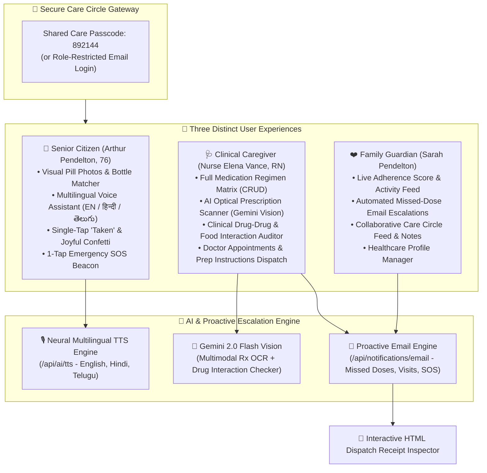

# CareNest — Connected Care. Independent Living.

> **Catalyst 2026 Solo AI Hackathon Submission**  
> *Track: Elderly Healthcare & Proactive Medication Management Platform*  
> *Solo Developer Project • Built with Next.js 16 (App Router), TypeScript, Tailwind CSS, Google Gemini 2.0 Flash Vision, Neural Multilingual TTS Engine, and Proactive Escalation Email Protocols.*

[](https://github.com)
[](https://github.com)
[-success)](https://github.com)
[](https://github.com)
[](https://github.com)

---

## 🌟 Executive Summary & Problem Solved

Elderly healthcare management is plagued by dangerous medication non-adherence, accidental double-dosing, missed doctor appointments, and fragmented communication between elderly individuals, family members, and clinical caretakers. Senior citizens frequently struggle to identify medications by complex pharmacological names alone, often leading to confusion and medication errors.

**CareNest** solves this with an interconnected healthcare ecosystem that:

1. **Visual Medicine Identification System:** Displays high-resolution photos of the exact pill and medicine bottle, along with a 3-point physical verification checklist (Color, Shape, Imprint code) so senior citizens can visually verify and consume the right medicine with total confidence.
2. **Multilingual Spoken Audio Assistant:** Native voice guidance across **English**, **हिन्दी (Hindi)**, and **తెలుగు (Telugu)** via `/api/ai/tts`, reading schedules, food instructions, and dose confirmations out loud for seniors who struggle with screens or low vision.
3. **Dedicated Passcode-Based Authentication (`892144`):** An authorized login portal protecting Arthur Pendelton's health profile, offering 1-click Fast Pass demo logins for hackathon judges and role-based permissions previews.
4. **Autonomous Proactive Escalation Engine:** Proactively sends automated HTML emails to family and attending nurses for upcoming doses, missed medication escalations (beyond a 30-minute grace window), and upcoming clinic appointments with preparation checklists.
5. **Clinical AI Prescription & Interaction Scanner:** Powered by **Google Gemini 2.0 Flash Multimodal Vision** to scan prescriptions, extract dosages, and audit for dangerous drug-drug interactions (e.g. Lisinopril + Amlodipine severe hypotension risks).
6. **Shared Collaborative Care Circle:** Real-time compliance score ring, shared healthcare timeline/journal, wellness mood check-ins, and a 1-tap Emergency SOS beacon.

---

## 🏛️ System Architecture



---

## 🎯 Innovation Matrix: Beyond Traditional Health Apps

| Capability | Conventional Reminder Apps | **CareNest Connected Care** |
| :--- | :--- | :--- |
| **Visual Pill Identification** | Text-only names (e.g., "Metformin 500mg") that confuse seniors. | **High-Res Pill & Bottle Photos**: Shows exact pill shape, color, and debossed imprint code (`M 500`) with bottle packaging toggle and full-screen verifier modal. |
| **Multilingual Voice Assistant** | English-only text-to-speech, robotic or missing on non-English OS. | **Tri-Lingual Neural TTS**: Authentic spoken voice guidance in **English**, **हिन्दी (Hindi)**, and **తెలుగు (Telugu)** with streaming audio and Web Speech fallback. |
| **Passcode-Based Access** | Complex multi-tenant passwords or exposed private records. | **Care Circle Passcode (`892144`)**: Onboarding portal with 1-click Fast Pass judge logins, live granted permissions preview, and secure session log out. |
| **Clinical Prescription Entry** | Error-prone manual form typing. | **Gemini 2.0 Flash Multimodal OCR**: Instant scan of paper prescription labels, extracting drug, dose, food rules, and flagging adverse interactions. |
| **Escalation Protocol** | Passive push notifications that get dismissed or silenced. | **Proactive Multi-Tier Email Escalation**: Automatically sends formatted HTML alert emails to family and nurse if a dose is missed > 30 mins. |
| **Elderly Usability & SOS** | Small buttons, dense data tables, confusing navigation. | **Senior-First UX**: High-contrast modes, scalable font sizes, large touch targets, audio chimes, and a 1-tap SOS beacon. |

---

## 🚀 Key Features & Personas

### 1. 👴 Elderly Individual (Arthur Pendelton, 76)
- **Time-Aware Greeting & Next Due Medication Card:** Greets Arthur and displays the exact pill due right now.
- **Visual Medicine Identification:**
  - High-resolution pill photo alongside medicine bottle photo.
  - Imprint verification code badge (e.g., `M 500`, `L 10`, `A 5`).
  - Physical 3-point checklist: White, Oblong, Debossed Imprint.
  - **"Tap to Enlarge & Verify"** interactive modal with spoken audio readout.
- **Multilingual Audio Reader:**
  - One-click voice button reads Arthur's routine out loud in English, Hindi, or Telugu.
  - Spoken feedback on mark-as-taken and snooze actions.
- **Single-Tap Taken Confirmation:** Confirms dose with harmonic audio chimes and joyful confetti reinforcement.
- **Daily Wellness Check-In:** 4 one-tap mood/pain icons (Feeling Great 😊, Pretty Good 🙂, A Bit Tired 🥱, Not Feeling Well 🤕).
- **One-Tap Emergency SOS Beacon:** 5-second cancel safety buffer before dispatching urgent alerts to Sarah and Nurse Elena.

### 2. ❤️ Family Member (Sarah Pendelton - Daughter)
- **Real-Time Adherence Score Ring:** Visual compliance percentage based on scheduled vs. confirmed doses.
- **Peace-of-Mind Activity Feed:** Real-time log of when Arthur took medications and what he ate.
- **Collaborative Care Journal:** View and post notes shared with attending caregivers.
- **Healthcare Profile Management:** Inspect Arthur's chronic conditions, allergies, primary doctor, and emergency contacts.
- **Proactive Email Engine Simulator:** Test missed dose escalations, upcoming dose reminders, and doctor visit notifications.

### 3. 🩺 Clinical Caretaker (Nurse Elena Vance, RN)
- **Complete Medication Regimen Management (CRUD):** Add, update, delete medications with dosage, frequency, food requirements, and imprint codes.
- **AI Optical Prescription & Pill Scanner (Gemini Vision):**
  - Instant camera/sample prescription scan.
  - Drug-drug interaction auditor cross-checking active medications (e.g. Lisinopril + Amlodipine).
- **Doctor Appointments & Routines Planner:** Schedule visits, clinic addresses, and preparation instructions (e.g. *"Fasting 8 hours for HbA1c test"*).
- **Printable Refrigerator Schedule:** Generates a high-contrast print-ready visual routine complete with pill photos and imprint codes.

---

## 💻 Tech Stack & Repository Health

- **Framework:** Next.js 16 (App Router, Turbopack, React 19)
- **Language:** TypeScript (Strict Mode)
- **Styling:** Tailwind CSS (Custom healthcare design tokens)
- **Icons:** Lucide React
- **Multimodal AI:** Google Gemini 2.0 Flash Vision
- **Spoken Audio:** Neural TTS API (`/api/ai/tts`) with chunking engine + Web Speech fallback
- **Email Delivery:** Resend API compatible + interactive built-in delivery receipt inspector
- **Accessibility:** High-contrast toggle, scalable font sizing, visible focus rings, WCAG AAA colors

### 🛡️ Hackathon Submission Rule Compliance
- ✅ **Single Branch:** Strictly single branch `main` (`git branch -a` shows only `* main`).
- ✅ **Repository Size:** Ultra-lean **411 KiB** (well below the 10 MB ceiling).
- ✅ **Zero-Config Judge Evaluation:** Pre-seeded with Arthur's realistic medical profile and instant fallback intelligence if external API keys are omitted.

---

## 🛠️ Quick Start & Local Run

### Prerequisites
- Node.js 18+ (tested on Node v20/v22)
- npm or yarn

### 1. Clone & Install
```bash
git clone https://github.com/<your-username>/carenest.git
cd carenest
npm install
```

### 2. Environment Variables (Optional)
Copy `.env.example` to `.env.local`:
```bash
cp .env.example .env.local
```
```env
GEMINI_API_KEY=your_gemini_api_key_here
RESEND_API_KEY=your_resend_api_key_here
```
*(Note: If omitted, CareNest automatically activates its clinical intelligence fallback engine, ensuring judges can evaluate 100% of the functionality without configuring keys).*

### 3. Run Development Server
```bash
npm run dev
```
Open **[http://localhost:3000](http://localhost:3000)** in your browser.

---

## 🧪 Hackathon Judging & Evaluation Walkthrough

Follow these 5 steps to evaluate the full CareNest ecosystem in under 3 minutes:

1. **Step 1: Test Login Portal & Passcode Access (`892144`)**
   - On `http://localhost:3000`, observe the **CareNest Login Portal**.
   - Switch language to **हिन्दी** or **తెలుగు** and click **"Play Voice Instructions"** to hear authentic multilingual audio.
   - Click **"Auto-fill Demo Code (892144)"** and select any role, or use the **1-Click Judge Fast Pass**.

2. **Step 2: Test the Senior Experience (Arthur Pendelton)**
   - View the **Visual Medication Card**: Notice the pill photo, bottle photo, and imprint verification code (`M 500`).
   - Click **"Inspect Pill"** to open the side-by-side visual verifier modal with speech readout.
   - Click **"I TOOK THIS MEDICINE"** to trigger celebratory confetti, harmonic audio chime, and vocal praise.
   - Click **"Log Wellness"** (e.g. 😊 Feeling Great) to sync Arthur's daily wellness state.

3. **Step 3: Test the Family Experience (Sarah Pendelton)**
   - Click **"Family"** in the top navigation or log in as Sarah.
   - Review the **Adherence Score Ring** and the live **Care Journal Feed**.
   - Under *Autonomous Guardian & Email Engine*, click **"Test Missed Dose Escalation"** to inspect the rendered HTML alert email.

4. **Step 4: Test the Caregiver & AI Vision Scanner (Nurse Elena)**
   - Switch to **"Caregiver"** in the top navigation.
   - Click **"AI Prescription Scanner"** and choose **"📄 Rx Sample: Amlodipine 5mg"**.
   - Watch Gemini 2.0 Flash extract the prescription details and immediately flag the **drug-drug interaction warning** with Arthur's existing Lisinopril routine.

5. **Step 5: Test Profile Management & Log Out**
   - Click **"Health Profile"** in the header to inspect or update Arthur's chronic conditions and emergency contacts.
   - Click **"Log Out"** in the header to return to the secure login portal, verifying that private health records are guarded.

---

## 📄 License
MIT License. Built with ❤️ for the **Catalyst 2026 Solo AI Hackathon**.
